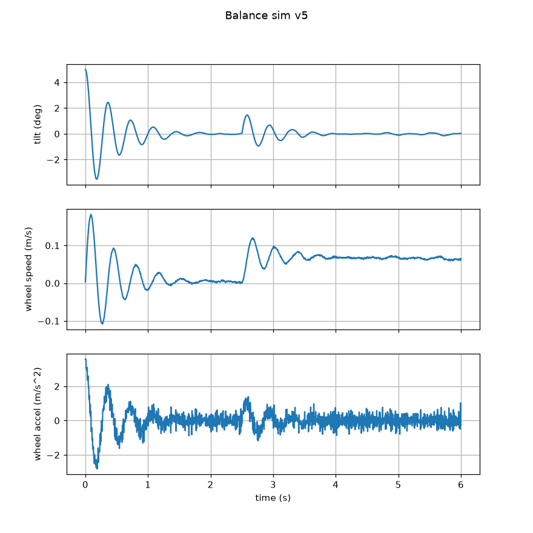

# Teeter

A two-wheel self-balancing robot with PID control.

**Status (Nov 2026):** design and simulation stage. I have purchased the parts, simulated the controller in Python, and ported it to an Arduino sketch. Nothing has been built or run on hardware yet.

## Overview
Teeter is a tall, narrow robot that stands on two wheels, like a small Segway. It cannot stand when powered off: it stays upright only by constantly driving its wheels back underneath its centre of mass. An IMU measures the tilt angle, a PID controller turns that into a wheel command, and two stepper motors carry it out about 200 times a second.

Physically it is an inverted pendulum, which is unstable on its own. The controller's job is to make it stable.

## Objectives
- Learn PID control by applying it to a real unstable system: the math, the discrete implementation, and tuning
- Combine mechanical design (3D-printed chassis), electronics (IMU, stepper drivers, battery power), and embedded code in one project
- Simulate the controller before building, to find rough gains and catch design problems early
- Understand every line of the robot code well enough to rebuild it from a blank file (see `Notes/learning_plan.md`)
- Build a portfolio project

## Requirements & Constraints
- Balance upright on two wheels and recover from a push
- Untethered: battery powered, with USB usable at the same time for tuning
- Use hardware on hand where possible: ELEGOO Mega 2560 R3 kit, one NEMA 17, one A4988, 3D printer
- Printed chassis, motor mounts, and wheels
- Target size roughly 15-20 cm tall, wheels 80-100 mm in diameter
- Motors must never be powered from the Arduino (lesson from my earlier peristaltic pump project, where I could not get more than 9 V to the motor)
- LiPo safety: balance charging only, do not discharge below about 3.3 V per cell

## Design Summary
**Layout (planned):**
- Bottom: two NEMA 17 steppers back to back, one wheel on each shaft
- Middle: printed shelves for the Arduino, the two drivers, and the buck converter. The IMU mounts flat and rigid, close to the wheel axle
- Top: the battery. A higher centre of mass falls more slowly, which gives the motors more time to correct

**Electronics:** a 3S LiPo (11.1 V) feeds both A4988 drivers directly through one switch. An LM2596 buck converter steps the battery down to 7.5 V for the Mega's Vin pin. The MPU-6050 talks to the Mega over I2C. Full pin list and diagram in `Electronics/`.

**Control:**
- Tilt angle from the MPU-6050, blending the gyro (smooth but drifts) with the accelerometer (noisy but does not drift)
- PID on tilt angle; the output is wheel acceleration, which is integrated to a wheel speed and sent to the steppers as step pulses from a timer interrupt
- An outer speed loop leans the robot back as it rolls faster, so it does not run away
- Control loop at 200 Hz; motors cut out past 45 degrees of tilt

**Key decisions:** steppers instead of DC gear motors (no backlash, no encoders needed), 3S LiPo instead of AA cells (steppers draw 1-2 A continuously), stay on the Mega for now. Reasoning in `Electronics/parts_list.md`.

## Tools & Technologies
- CAD: Solidworks (not started)
- Electronics: ELEGOO Mega 2560 R3, 2x NEMA 17 (17HS4401), 2x A4988, MPU-6050 (GY-521), 3S LiPo, LM2596 buck converter
- Manufacturing: P1S 3D printing PLA
- Software: Python with matplotlib (simulation), Arduino IDE / C++ (firmware)

## Testing & Results
**Simulation (done).** I modelled the robot as an inverted pendulum on a wheeled base and developed the PID loop over five versions. Full log in `Simulation/ITERATIONS.md`.

| Version | Change | Result |
|---|---|---|
| v1 | First attempt | Falls over in 0.13 s |
| v2 | Error sign fixed | Oscillation grows until it falls at 5.2 s |
| v3 | Derivative divided by dt | Balances, but with a perfect sensor and motor |
| v4 | Sensor noise, motor limits, shove added | Upright, but motor command pinned at its limit |
| v5 | IMU degrees converted to radians | Balances with a realistic command |

v5 starts from a 5 degree tilt, settles, and recovers from a shove within 0.12 s, with gains Kp = 40, Ki = 5, Kd = 2.4.

The physical numbers in the sim (centre-of-mass height, motor limits, IMU noise) are estimates, so these gains are a starting point, not final values.

**Arduino sketch (not yet on hardware).** I ran `Arduino/code/code.ino` on a PC against a simulated robot, where it balances and recovers from shoves. I have not yet compiled it in the Arduino IDE or run it on the real robot.

**Hardware:** to be filled in.

## Challenges & Lessons Learned
So far, from simulation:
- **Sign conventions matter.** My first version used the textbook `error = setpoint - measurement`, which made the robot fall faster than with no controller at all. For this system a forward lean needs a forward wheel acceleration.
- **A derivative is a rate.** Forgetting to divide by the loop period made the D term 200 times too small, which left the loop with no damping.
- **Units.** Feeding an angle in degrees into gains tuned per radian made the loop gain 57 times too high. The robot stayed up, so the pass/fail check did not catch it; only the motor command plot did.
- **A sim that passes is not necessarily a useful sim.** v3 balanced, but only by commanding 45 m/s² from an ideal motor.
- **The ideal sensor hid two real problems.** A real accelerometer reads "leaning back" whenever the wheels accelerate forward, and tilt feedback alone lets the robot roll away. My Arduino sketch needed an accelerometer correction and a speed loop that my Python sim did not.

Hardware lessons: to be filled in.

## Future Improvements
- Measure the real robot (centre-of-mass height, wheel diameter) and put those numbers in the sim
- Add the speed loop and accelerometer model to the Python sim, so sim and robot run the same controller
- Add a LiPo low-voltage alarm
- Move to an ESP32 for wireless gain tuning
- TPU tires or O-rings for grip
- Remote driving

## Folder guide
| Folder | Contents |
|---|---|
| `Simulation/` | Python sim v1-v5, a line-by-line commented v5, plots, and the iteration log |
| `Arduino/code/` | Arduino sketch for the Mega |
| `Electronics/` | Parts list, wiring table, wiring diagram |
| `Notes/` | Engineering log, PID math notes, learning plan |
| `CAD/` | Fusion 360 files and STLs (empty so far) |
| `Images/` | Build photos (empty so far) |
